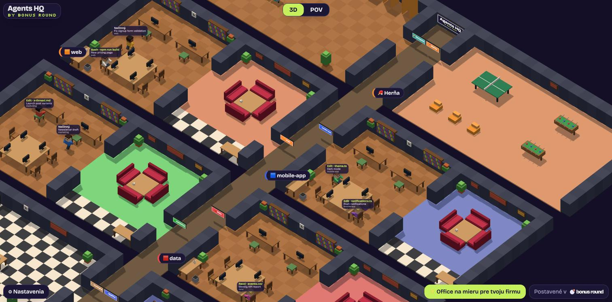

# Agents HQ

**Tvoji AI agenti pri práci v 3D office.**
Každý projekt má vlastnú miestnosť, agenti sedia pri stoloch, chodia na kávu a keď na teba čakajú, stoja na recepcii.



▶ [30-sekundové video: office zhora a v POV](docs/tour.mp4)

by [Bonus Round](https://bonusround.sk/agents-hq?utm_source=github&utm_medium=readme)

## Spustenie

Potrebuješ [Node.js](https://nodejs.org) 20 alebo novší. Do terminálu vlož:

```bash
npx agents-hq
```

Office sa otvorí v prehliadači.
Zastavíš ho cez `Ctrl+C`.

Bez terminálu po ruke? Napíš svojmu agentovi (Claude Code alebo Codex):

> Spusti mi Agents HQ príkazom `npx agents-hq` a otvor odkaz, ktorý vypíše.

Chceš si ho najprv len pozrieť? `npx agents-hq --demo` ukáže vymyslených agentov.

## Čo uvidíš

- **Miestnosť pre každý projekt.** Vznikne sama podľa priečinka, v ktorom agent pracuje.
- **Čo agent práve robí.** Nad hlavou má aktuálny krok, napríklad `Edit · App.tsx` alebo `Bash · npm test`.
- **Kto na teba čaká.** Agent, ktorý potrebuje tvoje schválenie, ide na recepciu.
  Hotový výsledok ti „volá“ z telefónnej búdky.
- **Prestávky.** Kuchyňa s kávovarmi, herňa, posilňovňa, sprchy a spálňa pre agentov, ktorí dlho nič nerobia.
- **Detail agenta.** Klikni na postavičku a uvidíš jeho poslednú konverzáciu.
- **3D pohľad zhora alebo POV**, v ktorom sa officom prechádzaš (WASD, myš).
- **Názov tvojej firmy** na tabuli v lobby, prepínač SK / EN.

Podporované agenty: **Claude Code** a **Codex CLI**.
ChatGPT, Claude.ai ani Cowork v prehliadači sa zobraziť nedajú, bežia v cloude, nie na tvojom počítači.
Ak používaš terminálový multiplexer **herdr**, Agents HQ ho využije: stavy agentov sú presnejšie a pribudne tlačidlo *Prejdi do terminálu*.

## Bezpečnosť

Agents HQ má prístup k tomu, na čom pracuješ, preto je postavený tak, aby nič nemohol pokaziť ani vyniesť:

- **Iba číta.** Pozerá sa na záznamy sessions, ktoré Claude Code a Codex aj tak ukladajú
  (`~/.claude/projects`, `~/.codex/sessions`).
  Nič v nich nemení, neinštaluje hooky a nesiaha na nastavenia agentov.
- **Agentom nič neposiela.** V kóde neexistuje cesta, ktorá by agentovi napísala, spustila alebo zastavila ho.
- **Nič neodchádza z počítača.** Server počúva iba na `127.0.0.1`.
  Stránka má Content-Security-Policy, ktorá prehliadaču zakáže pripojiť sa kamkoľvek inam.
  Žiadna analytika, žiadne cookies.
- **Prístup len s tajným kľúčom.** Odkaz obsahuje náhodný token, nový pri každom spustení.
  Iná stránka v prehliadači sa k officu pripojiť nevie (kontrola Host a Origin, ochrana proti DNS rebindingu).
- **Zapisuje len do vlastného priečinka** `~/.agents-hq` (jazyk, názov firmy, poradie stoličiek), práva `0700` a `0600`.

Odinštalovanie: `npx` si balík len stiahne do svojej cache, nič sa neinštaluje natrvalo.
Stačí zmazať `~/.agents-hq`.

Našiel si bezpečnostný problém? Pozri [SECURITY.md](SECURITY.md).

## Nastavenia

| Premenná | Predvolene | Čo robí |
|---|---|---|
| `--port` | `3200` | port na `127.0.0.1` |
| `--no-open` | | neotvorí prehliadač |
| `--demo` | | vymyslení agenti |
| `HQ_ACTIVE_MINUTES` | `45` | po koľkých minútach bez aktivity session zmizne |
| `HQ_NAP_MINUTES` | `15` | po koľkých minútach nečinnosti ide agent spať |
| `HQ_SHOWER_MINUTES` | `30` | po akej dlhej práci si dá sprchu |

Stav „čaká na teba“ je odhad: záznamy agentov nehovoria priamo, že čakajú na schválenie.
Agents HQ to usudzuje z príkazu, ktorý dlho nedostal výsledok.

## Office na mieru pre tvoju firmu

Vlastné miestnosti, vizuál postavičiek, pracovné benefity, napojenie ďalších projektov alebo celého AI tímu firmy?
Napíš mi na **[ahoj@bonusround.sk](mailto:ahoj@bonusround.sk?subject=Agents%20HQ%20na%20mieru)**.

## Autor

Agents HQ postavil **Juraj Zamborský**.
Growth marketér v [Donio](https://donio.sk), co-founder [Žurnálu](https://zurnal.sk), founder [Bonus Round](https://bonusround.sk) a [Klod.sk](https://klod.sk).
V Bonus Round robíme webové hry na mieru pre firmy.

## Licencia

MIT. Postavené na open-source projekte [Pixel Agents](https://github.com/pixel-agents-hq/pixel-agents) od Pabla De Luccu (MIT).
3D office, zdroje agentov a server sú nové.

---

## English

**Your AI agents at work in a 3D voxel office.** Every project gets its own room. Agents sit at their desks, grab coffee, and wait at the reception when they need you.

```bash
npx agents-hq          # your Claude Code and Codex sessions
npx agents-hq --demo   # made-up agents
```

Read-only: it reads the session logs Claude Code and Codex already keep, never writes to them, never talks to an agent, listens only on `127.0.0.1` behind a per-start token, and its Content-Security-Policy blocks any request off your machine. State lives in `~/.agents-hq`.

Want a custom HQ for your company (own rooms, character look, workplace perks)? [ahoj@bonusround.sk](mailto:ahoj@bonusround.sk?subject=Agents%20HQ)

Made by **Juraj Zamborský**: growth marketer at [Donio](https://donio.sk), co-founder of [Žurnál](https://zurnal.sk), founder of [Bonus Round](https://bonusround.sk) and [Klod.sk](https://klod.sk).
